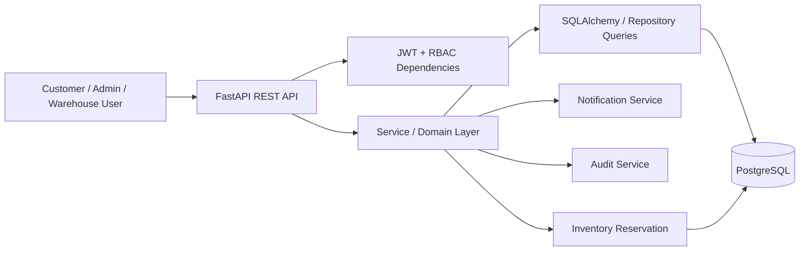

# Architecture

Routes validate HTTP input. Services own business rules and transaction boundaries. SQLAlchemy models represent persistent state. PostgreSQL row locks protect inventory reservation and transfers.
